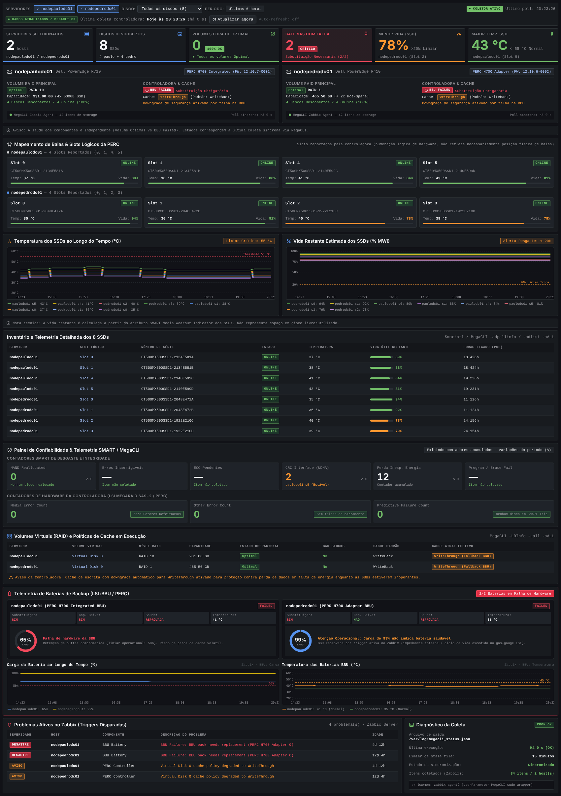

# Grafana — Storage Health (NOC)

Dashboard **Storage Health — Infraestrutura** (SSDs, RAID PERC e BBU via MegaCLI) feito em um único painel
**HTML graphics** (`gapit-htmlgraphics-panel`) alimentado pelo datasource **Zabbix** (`alexanderzobnin-zabbix-datasource`).

## Importar

1. Instale os plugins: `grafana-cli plugins install gapit-htmlgraphics-panel` e o Zabbix (`alexanderzobnin-zabbix-app`).
2. Grafana → Dashboards → New → Import → envie `storage-health-dashboard.json` e escolha o datasource Zabbix.

## Consultas (já configuradas)

| Ref | Modo Zabbix | Host | Item |
|-----|-------------|------|------|
| A | Metrics | `/.*/` | `/^(SSD .*: .*\|Slot .*: (Erros de midia\|Outros erros\|Falhas previstas)\|BBU .*: (Carga\|Temperatura))$/` |
| B | Text | `/.*/` | mesmo regex (itens texto: nº de série, estado, modelo) |
| C | Problems | `/.*/` | — (filtrado no painel por `problemFilter`) |

## Como os itens são interpretados

- `SSD <id>: <métrica>` — o número do slot vem do `<id>` (`Slot 0`, `0`, `[32:0]`…). A métrica é reconhecida por palavra-chave:
  `Temp*` → temperatura · `Vida/restante/Wear/MWI` → vida (%; "usada/used" é invertido) · `Horas/POH/Power On` → horas ligado ·
  `Serie/Serial` · `Modelo` · `Estado/Status` · `Realoc*` · `Incorrig*/Uncorrect*` · `Pend*` · `CRC/UDMA` · `Energia/Power loss` · `Program/Erase`.
- `Slot <n>: Erros de midia | Outros erros | Falhas previstas` → contadores da controladora, ligados ao SSD do mesmo slot.
- `BBU <id>: Carga | Temperatura` → cards, gauge e gráficos de BBU.
- BBU **FAILED** = problema ativo com BBU/Bateria/Battery no host, ou carga/temperatura acima do limiar crítico.
  Cache **WriteThrough** = problema ativo de cache/WriteThrough no host ou BBU em falha.

Dados que o MegaCLI não expõe como item (modelo do servidor, controladora, firmware, nível RAID, capacidade)
e os limiares ficam no **Code data** do painel (`storage-health/codeData.json`).

## Editar

Os fontes do painel estão em `storage-health/` (`html.html`, `style.css`, `onRender.js`, `codeData.json`).
Após alterar, rode `python3 storage-health/build.py` para regenerar o JSON.
